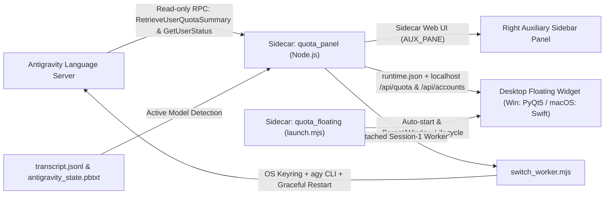

<div align="center">


# Antigravity Model Quota Monitor

**为 Google Antigravity 2.0 打造的实时模型配额监控与多账号一键切换插件 · 零 Token 消耗**

*Real-time 5-hour & weekly model quota monitor + local multi-account switcher for Google Antigravity — Right Auxiliary Sidebar + Auto-Docking Desktop Widget*

[](https://github.com/jibunrock40/antigravity-quota-monitor)
[-16a34a?style=flat-square)](https://github.com/jibunrock40/antigravity-quota-monitor)
[](https://github.com/jibunrock40/antigravity-quota-monitor)
[](LICENSE)

[界面预览](#preview) · [双形态特性](#features) · [多账号切换](#accounts) · [快速安装](#install) · [快捷操作](#controls) · [工作原理](#architecture) · [English Guide](#english-guide)

</div>

---

<a id="preview"></a>
## ✨ 界面预览（Visual Showcase）

插件同时提供**桌面左下角自适应迷你浮窗**与**右侧辅助边栏面板**两种入口，浅色 / 深色主题自动与客户端或系统同步：

### 1. 桌面迷你置顶浮窗（Windows & macOS，随 Antigravity 自动启停）
默认停靠在 Antigravity 左侧导航栏底部空白区域；点击迷你卡片即可向右展开全部模型配额与账号切换面板，也可点击 `钉` 切换为自由拖拽悬浮。


### 2. 右侧辅助边栏面板（全平台通用）
在对话右上角 **`+`** 菜单中选择 **`模型用量`** 即可打开，开箱即用、无需额外运行环境。


---

<a id="features"></a>
## 🎯 双形态功能对比（Dual Surfaces）

| 功能维度 | 右侧辅助边栏面板 (`quota_panel`) | 桌面迷你浮窗 (`quota_floating`) |
| :--- | :--- | :--- |
| **支持平台** | Windows / macOS / Linux 全平台 | **Windows**（Python 3.9+ & `PyQt5`）· **macOS**（原生 Swift `AppKit` + `WKWebView`，自动编译） |
| **启停方式** | 点击对话右上角 `+` → `模型用量` | **随 Antigravity 自动启动，关闭客户端后自动退出** |
| **当前模型焦点** | 自动识别当前对话 / 最近选用模型，展示 **5h + 一周用量** | 紧凑迷你卡常驻显示当前模型、思考档位及双进度条 |
| **全部模型展开** | 点击卡片一键展开全部分组与档位（`Low` ~ `XHigh`） | 左键点击迷你卡，向右弹出「模型配额 \| 账号切换」双页签面板 |
| **多账号管理** | 顶部账号栏折叠抽屉：保存当前、备注、删除、导入/导出与一键切换 | 展开弹窗 `账号切换` 页签 + 右键/系统托盘 `账号切换` 子菜单 |
| **双视角切换** | 顶部 `已用 / 剩余` 分段按钮切换（本地记忆偏好） | 弹窗与右键菜单支持 `已用视角 / 剩余视角` 实时同步 |
| **智能停靠与避让** | 紧贴客户端右侧辅助栏，自动跟随宿主主题 | 吸附 Antigravity 左下角，客户端最小化/被遮挡时自动隐藏；或切换 `浮` 自由拖拽 |
| **额外 Token 消耗** | **0 Token**（纯本地 Connect-RPC 只读查询） | **0 Token**（复用 `quota_panel` Sidecar 本地 HTTP 缓存） |

---

<a id="accounts"></a>
## 🔄 多账号快照与一键切换（Account Switcher）

插件内置纯本地、零硬编码密钥的多账号快照切换方案，同时兼容 `agy-switch` 本地账号库迁移：

* **纯本地凭据快照（MIT 开源安全）**：不内置或硬编码任何第一方 OAuth `Client Secret`。在 Antigravity 内登录好一个账号后，点击 **「保存当前」** 即可将系统凭据库中的登录快照安全存入本地目录（`~/.gemini/antigravity/sidecar_data/quota-monitor/quota_panel/data/vault/`）。
* **多源导入与 JSON 备份恢复**：
  * 一键从本机 `agy-switch` 账号库（`~/.antigravity_tools` / `ABV_DATA_DIR`）导入已有账号与备注。
  * 支持导入/导出 JSON 备份文件（兼容本插件格式及 `agy-switch` v1/v2 导出格式）。
* **缓存配额与自定义备注**：每次使用某个账号时，后台自动把最新 5h / 一周配额同步到本地账号元数据，切换前即可查看每个备用号的最近缓存余额；支持自定义简短备注。
* **安全一键重启切换（同步 `agy` CLI）**：
  * 点击切换并确认后，后台独立的脱离进程 Worker（Windows 通过 Task Scheduler `Schedule.Service` 交互会话交接脱离宿主 Job Object）会优雅关闭运行中的 Antigravity（以及共享登录态的 IDE 2.6+），校验并备份异常全零 `antigravity_state.pbtxt`，将目标账号写入系统凭据库（Windows Credential Manager / macOS Keychain / Linux Secret Service）及已初始化的 `~/.gemini/antigravity-cli/antigravity-oauth-token`，随后自动重新拉起 Antigravity。
  * 切换前会弹窗确认；正在运行中的对话任务不会跨账号迁移，请等待当前任务完成后切换。

---

<a id="install"></a>
## 🚀 快速安装（Installation）

### 方式一：使用 `agy` CLI 一键安装（推荐）

```bash
agy plugin install https://github.com/jibunrock40/antigravity-quota-monitor
```

### 方式二：使用 `git clone` 克隆到插件目录

* **Windows (PowerShell)**：
  ```powershell
  git clone https://github.com/jibunrock40/antigravity-quota-monitor.git "$env:USERPROFILE\.gemini\config\plugins\quota-monitor"
  ```

* **macOS / Linux**：
  ```bash
  git clone https://github.com/jibunrock40/antigravity-quota-monitor.git ~/.gemini/config/plugins/quota-monitor
  ```

### 方式三：手动下载 ZIP 安装

1. 在本仓库页面点击 **Code → Download ZIP** 并解压。
2. 将解压后的目录重命名为 `quota-monitor`，放置到 Antigravity 插件目录（确保 `plugin.json` 直接位于该目录下，**不要多嵌套一层子目录**）：
   * **Windows**：`%USERPROFILE%\.gemini\config\plugins\quota-monitor\`
   * **macOS / Linux**：`~/.gemini/config/plugins/quota-monitor/`

> 安装完成后 Antigravity 会自动发现并加载插件（也可在左侧边栏 **个性化定制 / Customizations** 中确认已启用）。

---

### 🖥️ 开启桌面迷你浮窗（Windows & macOS 可选配置）

**右侧辅助边栏面板无需任何额外依赖**即可在所有平台直接工作；若希望同时启用左下角桌面迷你浮窗：

#### macOS（原生 AppKit + WKWebView，零 Python / 零系统权限依赖）
1. 确保本机已安装 Xcode Command Line Tools（大多数开发环境已自带；若未安装，执行 `xcode-select --install`）。
2. 重启 Antigravity（或在「个性化定制」中重新开关一次插件），后台启动器 `launch.mjs` 会在首次启动时自动使用 `swiftc` 编译并缓存原生浮窗二进制（`~/.gemini/antigravity/sidecar_data/quota-monitor/quota_floating/bin/quota-floating-widget`），**无需辅助功能或屏幕录制权限**，支持跟随全屏 Space、窗口拖拽吸附、遮挡自动避让、自由悬浮与菜单栏图标。
3. 如需手动独立拉起浮窗，也可运行 `bash widget/start_widget_macos.sh`。

#### Windows（Python + PyQt5）
安装 `PyQt5`：

```bash
pip install -r requirements.txt
# 或直接安装：
pip install PyQt5
```

1. 重启 Antigravity（或在「个性化定制」中重新开关一次插件），后台启动器 `launch.mjs` 会自动探测常见 Python / Anaconda / Miniconda / venv 环境中的 `PyQt5` 并拉起浮窗。
2. 如需指定特定的虚拟环境 Python，可设置环境变量 `ANTIGRAVITY_QUOTA_PYTHON` 指向该环境下的 `pythonw.exe` 或 `python.exe`。
3. 未安装 `PyQt5` / `swiftc` 或在 Linux 上运行时，启动器会安静跳过，**完全不影响右侧边栏面板使用**。
4. 如需手动独立调试或拉起浮窗，Windows 可直接运行 `widget\start_widget.vbs`（无黑框静默启动）或 `widget\start_widget.bat`。

---

<a id="controls"></a>
## 🖱️ 快捷操作与交互（Controls）

| 入口 | 操作 | 效果 |
| :--- | :--- | :--- |
| **桌面迷你浮窗** | **左键单击卡片** | 展开 / 收起详情弹窗（支持切换 `模型配额` \| `账号切换` 双页签） |
| **桌面迷你浮窗** | **点击右上角 `钉 / 浮`** | 在「吸附客户端左下角」与「自由拖拽悬浮」间切换 |
| **桌面迷你浮窗** | **自由模式下按住卡片拖拽** | 任意摆放桌面位置，自动记忆坐标并在同屏安全区域内约束 |
| **展开弹窗** | **`已用视角` / `刷新` / `×` (或 `Esc`)** | 切换已用/剩余显示、强制刷新本地缓存、收起详情弹窗 |
| **展开弹窗 (`账号切换`)** | **`保存当前` / `导入 agy-switch` / `切换`** | 保存当前登录快照、导入本地 `agy-switch` 账号或确认重启切换 |
| **浮窗右键 / 托盘图标** | **右键菜单 → `账号切换`** | 在系统托盘或右键菜单快速保存、导入并确认切换账号 |
| **右侧边栏面板** | **对话右上角 `+` → `模型用量`** | 打开右侧边栏视图；顶部可展开账号抽屉、备注/删除、导入/导出 JSON 与一键切换 |

---

<a id="architecture"></a>
## 🧠 工作原理（零 Token 消耗）



* **零额外额度消耗**：插件不会向任何大模型发起推理请求，只读取 Antigravity 本地 Language Server 的配额汇总接口，并自带 10 秒服务端缓存与 30 秒前后端轮询。
* **纯本地隐私运行**：所有配额统计与账号凭据均仅保存于本机回环服务与个人数据目录（`sidecar_data` / 系统凭据管理器），绝不上传任何账号信息、OAuth Token、对话内容或配额数据到第三方服务器，源码中不包含任何硬编码密钥。

---

## 📁 目录结构（Directory Layout）

```text
quota-monitor/
├── plugin.json                         # Antigravity 插件清单
├── requirements.txt                    # Windows 浮窗可选依赖 (PyQt5>=5.15)
├── LICENSE                             # MIT License
├── assets/
│   ├── logo.svg                        # 插件图标
│   ├── preview-floating.png            # 桌面浮窗预览图
│   └── preview-sidebar.png             # 右侧边栏面板预览图
├── sidecars/
│   ├── quota_panel/                    # 全平台右侧边栏 Web UI Sidecar + 账号切换后端
│   │   ├── sidecar.json
│   │   ├── package.json
│   │   ├── main.mjs
│   │   ├── keyring.mjs                 # 跨平台系统凭据库 + agy CLI 会话同步
│   │   ├── accounts_store.mjs          # 本地账号快照库、缓存配额与 JSON/agy-switch 导入导出
│   │   ├── switch_worker.mjs           # 脱离宿主进程树的优雅关闭、状态恢复与重启切换 Worker
│   │   ├── index.html
│   │   ├── styles.css
│   │   └── app.js
│   └── quota_floating/                 # Windows & macOS 桌面浮窗跨环境托管启动器
│       ├── sidecar.json
│       ├── package.json
│       └── launch.mjs
└── widget/                             # 桌面迷你浮窗与手动启动器
    ├── quota_floating_widget.pyw       # Windows PyQt5 桌面迷你浮窗
    ├── start_widget.vbs
    ├── start_widget.bat
    ├── start_widget_macos.sh           # macOS 手动启动脚本
    └── macos/                          # macOS 原生 Swift (AppKit + WKWebView) 浮窗
        ├── QuotaFloatingWidget.swift
        └── widget.html
```

---

## ❓ 常见问题（FAQ）

1. **右侧边栏的 `+` 菜单里没有出现「模型用量」？**
   请确认 `plugin.json` 直接位于 `~/.gemini/config/plugins/quota-monitor/plugin.json`（解压 ZIP 时注意不要多套一层文件夹），并在左侧「个性化定制」中确保插件处于启用状态。
2. **Windows 桌面浮窗没有自动出现？**
   可在终端运行 `python -c "import PyQt5.QtWidgets; print('OK')"` 验证当前 Python 是否已安装 `PyQt5`。若 `PyQt5` 安装在特定 Conda / venv 中，请将 `ANTIGRAVITY_QUOTA_PYTHON` 环境变量设为对应的 `pythonw.exe` 路径；也可查看 `%USERPROFILE%\.gemini\antigravity\sidecar_data\quota-monitor\quota_panel\data\widget.log` 排查启动记录。
3. **关闭 Antigravity 后浮窗会不会残留在桌面？**
   默认启用了「随 Antigravity 关闭自动退出」：浮窗会监听父进程与主窗口生命周期，客户端退出几秒内自动清理托盘与进程（最小化客户端窗口只会自动隐藏浮窗，不会误退出）。
4. **为什么切号不像某些独立客户端那样后台自动刷新未登录账号的实时配额？**
   本插件坚持 MIT 纯净开源且**不内置任何第一方 OAuth 密钥**。切换前展示的是上次登录该账号或导入时缓存的配额快照；在激活该账号后，面板会自动获取并刷新实时配额。

---

<a id="english-guide"></a>
## 🌍 English Guide

### Overview

**Antigravity Model Quota Monitor** is a local, zero-token-cost quota monitor and multi-account switcher plugin for **Google Antigravity 2.0**. It combines a cross-platform **Right Auxiliary Sidebar Panel** with an optional **Always-On-Top Auto-Docking Desktop Widget (Windows & macOS)**, letting you inspect **5-hour** & **weekly** quotas and switch saved Antigravity accounts in one click.

### Key Highlights

* **Cross-Platform Sidebar Panel (`quota_panel`)**: Works out-of-the-box on Windows, macOS, and Linux via the conversation `+` → **`模型用量`** menu. Shows active model 5h & weekly usage bars, all model groups with thinking-tier badges, and a collapsible account manager bar.
* **Local Multi-Account Snapshot & Switching**:
  * **Zero Hardcoded Secrets**: Captures your currently signed-in Antigravity credential snapshot directly from the OS credential store (`gemini:antigravity` on Windows Credential Manager, macOS Keychain, or Linux Secret Service) into a local vault (`0600`).
  * **Import / Export & `agy-switch` Migration**: One-click import from `~/.antigravity_tools` (`ABV_DATA_DIR`) as well as JSON backup export/restore.
  * **Safe Detached Restart**: Spawns a process-tree-detached worker (`Schedule.Service` interactive Session-1 handoff on Windows) that gracefully closes Antigravity (and shared-login IDE 2.6+), recovers corrupt all-zero `antigravity_state.pbtxt` files if detected, writes the target credential and initialized `agy` CLI session (`~/.gemini/antigravity-cli/antigravity-oauth-token`), and relaunches Antigravity.
* **Floating Mini Widget (`quota_floating`, Windows & macOS, Optional)**: Auto-starts and exits with Antigravity, docks into the bottom-left sidebar area (or switches to draggable `浮` mode), and provides a tabbed `模型配额 | 账号切换` popover plus tray/menu-bar quick-switch menus.
* **Strictly Local & Zero Token Cost**: Queries local Language Server Connect-RPC endpoints (`RetrieveUserQuotaSummary` & `GetUserStatus`) over `127.0.0.1` with a 10s cache—consuming **0 LLM tokens**.

### Quick Install

```bash
# Option 1: Antigravity CLI (Recommended)
agy plugin install https://github.com/jibunrock40/antigravity-quota-monitor

# Option 2: Git Clone (macOS / Linux)
git clone https://github.com/jibunrock40/antigravity-quota-monitor.git ~/.gemini/config/plugins/quota-monitor
```

```powershell
# Option 2: Git Clone (Windows PowerShell)
git clone https://github.com/jibunrock40/antigravity-quota-monitor.git "$env:USERPROFILE\.gemini\config\plugins\quota-monitor"
```

* **Option 3 (ZIP)**: Download the repository archive, rename the extracted folder to `quota-monitor`, and place it under `~/.gemini/config/plugins/quota-monitor/` (Windows: `%USERPROFILE%\.gemini\config\plugins\quota-monitor\`).

#### Enable the Optional Desktop Floating Widget (Windows & macOS)

The right-sidebar panel requires zero extra dependencies.

- **macOS (Native Swift `AppKit` + `WKWebView`)**: Requires Xcode Command Line Tools (`xcode-select --install`, usually pre-installed). On first launch, `launch.mjs` automatically compiles and caches the native widget binary with **zero Accessibility or Screen Recording permissions required**. Run `bash widget/start_widget_macos.sh` to start manually.
- **Windows (`PyQt5`)**:

```bash
pip install -r requirements.txt
# or: pip install PyQt5
```

Restart Antigravity (or toggle the plugin once in Customizations). On Windows, if your `PyQt5` lives inside a custom virtual environment, point `ANTIGRAVITY_QUOTA_PYTHON` to its `pythonw.exe`. On Linux or systems without the widget prerequisites, `launch.mjs` exits cleanly with code `0` so the sidebar panel remains completely unaffected.

### License

Released under the [MIT License](LICENSE).
